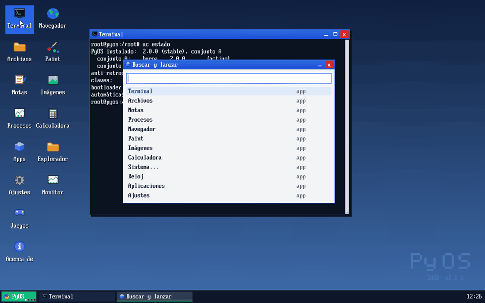

# PyOS — Python Operating System

**Version 2.0.1** · License [Apache-2.0](LICENSE) · Versioning [U.P.S.](CHANGELOG.md) (Update.Patch.Security)

An operating system with a kernel written **entirely in Python**, booting inside a virtual machine **without Linux or any other operating system underneath**: only the machine's UEFI firmware.

```text
UEFI Firmware ─► UEFI Shell ─► Python.efi (CPython 3.6.8 for UEFI)
                  ─► start.py ─► Real Hardware HAL ─► PyOS BIOS ─► Boot Selector
                       ├─ PyOS Term / PyOS LOOK ─► PyOS bootloader ─► PyOS kernel ─► PVM processes
                       └─ Ubuntu / Arch / Kali… (if installed) ─► their actual Linux kernel
```

Dual kernel, dual execution and the status of each component (implemented / experimental / impossible and why): `docs/ARCHITECTURE.md` (included in the Release `.zip`).

No project code is written in C, C++, Rust or assembly. `Python.efi` and the UEFI Shell are third-party binaries compiled **without modifications** from the official TianoCore sources (`edk2`, `edk2-libc`). They serve the same purpose as the CPython binary on a PC: the interpreter in which our Python code runs.

## PyOS 2.0.0 in action

Real screenshots captured from the VM running the PyOS 2.0.0 UEFI image in QEMU 8.2 + OVMF (TCG emulation, without KVM). Nothing is simulated or edited. Only loading delays have been trimmed, frames captured during partial screen redraws have been removed, and the result has been scaled to 960×600.

### Boot: from UEFI firmware to LOOK

UEFI Shell, `start.py`, the boot selector, kernel startup messages and the LOOK desktop.


### LOOK: Terminal

LOOK's graphical terminal running `uc estado`: installed version, A/B slots and update policy. Under TCG emulation, the window takes some time to open; that delay has been trimmed.


### LOOK: Launcher and Monitor

Alt+L opens "Search and Launch". Opening Monitor displays memory, volumes, services and PVM processes in real time.



### LOOK: Virtual desktops and File Explorer

Switching to desktop 2 using the indicators on the PyOS button, opening File Explorer from the launcher and returning to desktop 1, where Monitor remains open.


### PyOS Term: Administration

`uc estado`, `svc list` and `monitor` commands running in the PyOS Term console.


### PyOS Term: Games

Full-screen `tetris` running in the firmware console.


### Update Center: A/B update

`uc importar` imports a 2.0.1 test package signed with the development key. This is followed by a reboot, a test boot into the other slot, automatic confirmation and `uc historial`.


## Try it

## 📦 Releases

This repository is the project's showcase. **The source code is distributed through Releases**: each version includes a `PyOS-vU.P.S.zip` containing the entire PyOS project (kernel, userland, LOOK, tests, documentation and build tools), along with ready-to-boot disk images.

Download the latest version from **[Releases](../../releases)**:

| Hypervisor | File | Firmware |
|---|---|---|
| VirtualBox | `pyos-vU.P.S.vdi` | EFI enabled, **1 CPU** (with 2 or more CPUs, VirtualBox 7.2.4 may fail in its own EFI firmware) |
| Hyper-V (Gen 2) | `pyos-vU.P.S.vhdx` | Secure Boot **disabled** |
| VMware | `pyos-vU.P.S.vmdk` | UEFI, without Secure Boot |
| QEMU | `pyos-vU.P.S.img` | OVMF |

Step-by-step guide: `docs/VM.md` (included in the Release `.zip`). For networking in VirtualBox, use a NAT adapter of type *Intel PRO/1000 MT Desktop* (see `docs/NET.md` in the `.zip`).

On the host machine (development environment, with the VM emulated), run these commands from the extracted `.zip` directory:

```bash
python -m pyos mkimage pyos.img && python -m pyos run pyos.img
python -m pyos run pyos.img --linux           # on a Linux host: enables 'lx' (actual Linux processes)
python -m pytest                              # full test suite (3.13); the kernel also runs on 3.6
python tests/look_fuzz.py 1 80                # graphical environment fuzzer
python tests/uefi_smoke.py build/uefi/pyos-uefi.img [linux-disk.img]  # real UEFI image in QEMU+OVMF
sudo python -m pyos.tools.mkuefi build/uefi   # builds VM images (Linux/WSL2)
```

## What's real

### Hardware managed by Python-written drivers

| Device | Implementation |
|---|---|
| **ACPI PM Timer** (3.58 MHz) | Located by scanning the PCI bus (PIIX4 / ICH9) and read through I/O ports |
| **ACPI Power Button** | `PM1_STS.PWRBTN_STS`: orderly shutdown (in VirtualBox: Machine → ACPI Shutdown) |
| **PS/2 Keyboard** (i8042) | The firmware releases it (`disconnect`) and PyOS reads scancodes from port 0x60. Layouts `es`, `latam`, `us`, `gb`, `de`, `fr`, `it`, `pt` and `br`, dead keys (á, ü…), Ctrl+Alt+Del |
| **16550 UART** (COM1) | Registers 0x3F8–0x3FF, using polling |
| **PCI Bus** | Bus 0 enumeration (`/proc/pci`, `hwinfo`) |
| **Intel e1000** (82540EM) | MMIO through BAR0, DMA rings in physical RAM, DHCP. TCP/IP stack written in Python: `docs/NET.md` (included in the Release `.zip`) |
| **Physical RAM** | 16 MiB reserved for firmware: the frame map and **page tables reside in actual physical RAM** |

The firmware is only used for three things: the text console, the FAT filesystem containing PyOS's `disk.img` file, and the final reboot/shutdown operation. This is similar to what DOS did with the BIOS.

### Kernel

- **Memory:** frame allocator and two-level x86-style paging, VMAs, demand paging, `sbrk`, `mmap`, `mprotect` and `SIGSEGV`.
- **Interrupts:** 256-vector IDT. IRQ0 (timer), IRQ1 (keyboard), IRQ4 (UART), IRQ9 (ACPI), #PF (14) and syscalls (0x80).
- **Processes:** instruction-preemptive round-robin scheduler, actual `fork()`, `exec()`, `waitpid`, zombies, reparenting to init and signals with **user-space handlers**.
- **Filesystem:** PyFS on disk (inodes, bitmaps, indirect blocks, fsck), VFS, devfs, procfs (including `/proc/<pid>/stack`) and pipes.
- **Boot:** PyOS BIOS with POST. The bootloader verifies the kernel image's SHA-256 hash and imports it from disk sectors.

### The PVM virtual CPU

User programs are **not** executed by the host interpreter. PyOS compiles them into its own instruction set (`kernel/cpu/isa.py`, `compiler.py`) and executes them on its own virtual CPU (`kernel/cpu/vm.py`), with explicit frames. This enables:

- **Exact preemption:** the kernel regains CPU control after N instructions from any program, including `while True: pass`.
- **Syscalls as real traps:** the `CALL` instruction targeting the syscall gate stops the CPU and returns control to the kernel.
- **Real isolation:** internal objects are opaque, there is no `import`, builtins are minimal and special attributes are filtered. `/bin/sandbox` tests 10 escape paths, all of which are blocked.
- **Actual `fork()`:** copies the complete CPU and memory state; even generators suspended midway through execution are duplicated.
- **Bounded execution cost and quotas** (since 1.0.2): no instruction can keep the scheduler from regaining control (`10 ** 10 ** 8`, `sum(range(10 ** 12))`, a non-terminating `__hash__`…). Each process has a memory quota and, optionally, a CPU limit (`ulimit -m` / `ulimit -t`).

The compiler supports functions, closures, generators, classes with inheritance and special methods, `try/except/finally`, `with`, comprehensions, f-strings and unpacking. It passes an equivalence test suite against CPython on versions 3.13 and 3.6.

## Userland

Shell with `|`, `<`, `>`, `>>`, `&` and `jobs`. There are 49 base programs plus games (`ls cat ps top kill free df dmesg memtest forktest sigtest sandbox hwinfo edit python lx ifconfig ping wget nc…`). `edit` can be used to write Python programs from inside PyOS.

### PyOS LOOK (graphical environment, preinstalled)

Option 1 in the boot selector, or run `look` from the shell. Desktop with icons, taskbar, menu, movable and resizable windows that snap to screen edges, and applications: Terminal, Files, Notes, Processes, Web Browser (HTTP over PyOS's TCP/IP stack), Paint, Images, Calculator, Calendar, Applications (`pkg`), Settings (themes, high contrast, background, keyboard, services) and Games (Minesweeper, Snake, Arcade). Clipboard, mouse wheel, context menus and third-party applications in `/usr/share/look/apps` (`LOOK_API = 1`).

The kernel writes to the video adapter's actual framebuffer and handles the PS/2 mouse; LOOK is a PVM process. Details, VM requirements and limitations: `docs/LOOK.md` (included in the Release `.zip`).

### 2D Games (`arcade`, preinstalled)

`arcade` opens the menu; individual games can also be launched directly: `snake`, `tetris`, `pong`, `breakout`, `invaders`, `2048`, `minas`. Full-screen at 10–25 fps, raw PS/2 keyboard input, high scores stored in `/var/games`. Q exits; Ctrl-C also works (the kernel restores the console).

How it works: the console supports raw mode and non-blocking input (`ttyctl`, syscall 57). Programs draw using standard ANSI sequences; in UEFI mode, the kernel translates them into `SetCursorPosition` (through `lseek` on edk2-libc's stdout) and writes UTF-8, so the UEFI font's drawing glyphs are displayed (█ ░ ║ ▲). `/lib/tui.py` implements double buffering and only sends changed content.

The firmware console is **monochrome**: Python has no access to `SetAttribute`. In hosted mode (the host terminal), colors do work.

### PyOS Term (administration)

| Command | Description |
|---|---|
| `pyos` | System status: version, memory, disk, Linux, LOOK and services |
| `pkg avail/install/remove/list/files/verify/info` | `PYOSPKG 1` packages with dependencies and conflict detection (local repository: `extras`, `juegos`) |
| `svc list/start/stop/restart/enable/disable` | Services in `/etc/svc`; `logd` writes the kernel log to `/var/log/kernel.log` |
| `dev`, `dev pci`, `dev irq`, `dev kbd es\|us` | Devices, IRQs and live keyboard layout switching |
| `lx [-i] command`, `lx shell` | Actual Linux kernel programs (only when PyOS is hosted on Linux with `--linux`) |

Limitations, design decisions and alternatives: `docs/LIMITATIONS.md` (included in the Release `.zip`).

## Project

- [CHANGELOG.md](CHANGELOG.md): changes in each version and the U.P.S. versioning policy.
- `CONTRIBUTING.md` (included in the Release `.zip`): how to contribute (and the golden rule: everything in Python).
- [SECURITY.md](SECURITY.md): how to report a vulnerability.
- [docs/](docs/): security reports for each version, including measured before-and-after results.
- License: [Apache-2.0](LICENSE). Third-party components and their licenses: [NOTICE](NOTICE) and [`licenses/`](licenses).
