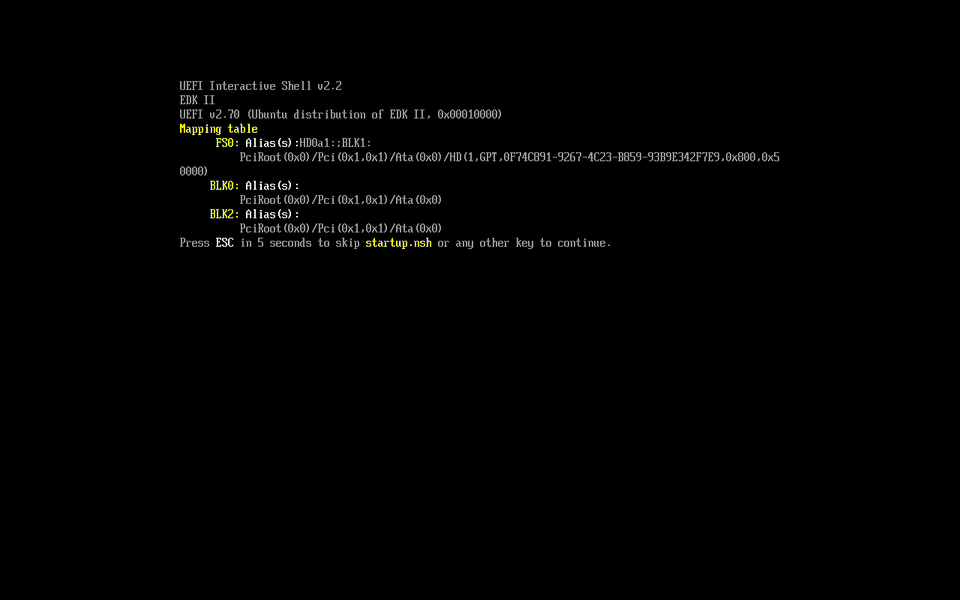
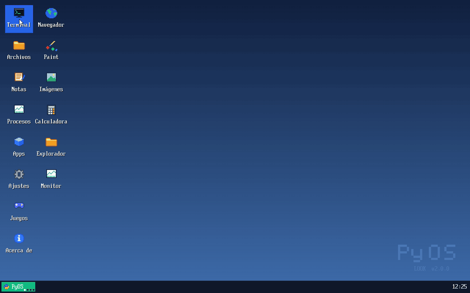
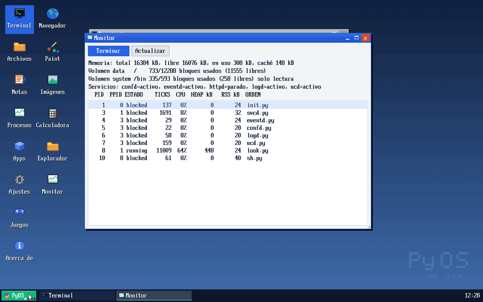
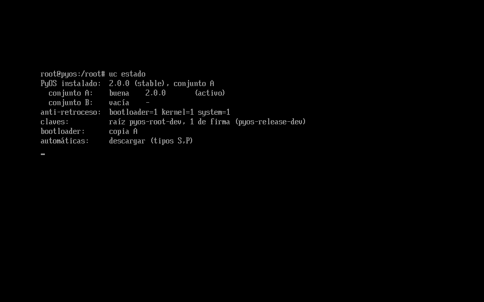
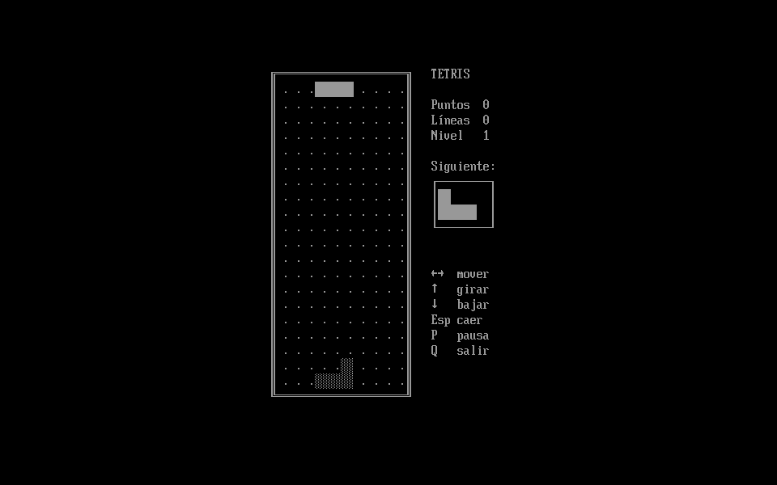
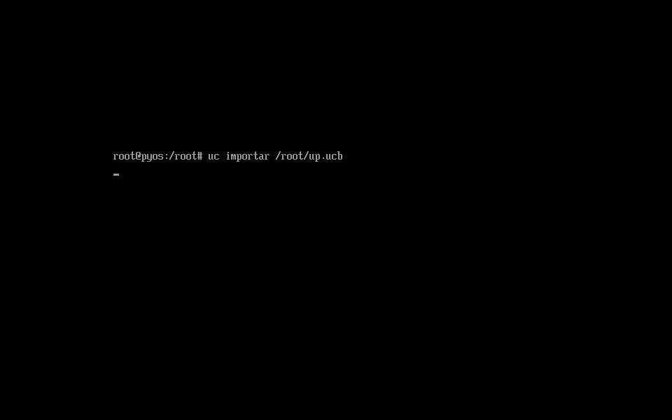

# PyOS — Python Operating System

**Versión 2.0.1** · Licencia [Apache-2.0](LICENSE) · Versionado [U.P.S.](CHANGELOG.md) (Update.Patch.Security)

Sistema operativo con el kernel escrito **íntegramente en Python** que arranca en una
máquina virtual **sin Linux ni ningún otro sistema operativo debajo**: solo el
firmware UEFI de la máquina.

```
Firmware UEFI ─► UEFI Shell ─► Python.efi (CPython 3.6.8 para UEFI)
              ─► start.py ─► HAL de hardware real ─► BIOS PyOS ─► selector de arranque
                   ├─ PyOS Term / PyOS LOOK ─► bootloader PyOS ─► kernel PyOS ─► procesos PVM
                   └─ Ubuntu / Arch / Kali… (si están instaladas) ─► su kernel Linux real
```

Dual kernel, ejecución dual y estado de cada pieza (implementado / experimental /
imposible y por qué): `docs/ARCHITECTURE.md` (en el `.zip` de la Release).

Nada del proyecto está escrito en C, C++, Rust ni ensamblador. `Python.efi` y el
UEFI Shell son binarios de terceros compilados **sin modificar** desde las fuentes
oficiales de TianoCore (`edk2`, `edk2-libc`). Tienen el mismo papel que el
binario de CPython en un PC: el intérprete donde corre nuestro Python.

## PyOS 2.0.0 en marcha

Capturas reales de la pantalla de la VM con la imagen UEFI de PyOS 2.0.0 en QEMU 8.2 + OVMF
(emulación TCG, sin KVM). No hay nada simulado ni retocado. Solo se han recortado las esperas,
se han quitado los fotogramas capturados a mitad de un repintado y se ha escalado a 960×600.

### Arranque: del firmware UEFI a LOOK
UEFI Shell, `start.py`, el selector de arranque, el registro del kernel y el escritorio LOOK.



### LOOK: Terminal
Terminal gráfica de LOOK con `uc estado`: versión instalada, conjuntos A/B y política de
actualizaciones. Bajo emulación TCG la ventana tarda en abrirse; esa espera está recortada.



### LOOK: lanzador y Monitor
Alt+L abre «Buscar y lanzar». Al abrir Monitor se ven la memoria, los volúmenes, los servicios
y los procesos de la PVM en tiempo real.


### LOOK: escritorios virtuales y Explorador
Paso al escritorio 2 desde las marcas del botón PyOS, apertura del Explorador desde el
lanzador y vuelta al escritorio 1, que conserva el Monitor.



### PyOS Term: administración
`uc estado`, `svc list` y `monitor` en la consola de PyOS Term.



### PyOS Term: juegos
`tetris` a pantalla completa en la consola del firmware.



### Update Center: actualización A/B
`uc importar` de un paquete de prueba 2.0.1, firmado con la clave de desarrollo. Le siguen el
reinicio, el arranque de prueba en el otro conjunto, la confirmación automática y
`uc historial`.



## Probarlo

## 📦 Releases

Este repositorio es el escaparate del proyecto. **El código va en las Releases**: cada versión
trae su `PyOS-vU.P.S.zip` con todo PyOS (kernel, userland, LOOK, tests, documentación y
herramientas de construcción) y las imágenes de disco listas para arrancar.

Descarga la última versión en **[Releases](../../releases)**:

| Hipervisor | Fichero | Firmware |
|---|---|---|
| VirtualBox | `pyos-vU.P.S.vdi` | EFI activado, **1 CPU** (con 2 o más, VirtualBox 7.2.4 puede fallar en su propio firmware EFI) |
| Hyper-V (Gen 2) | `pyos-vU.P.S.vhdx` | Arranque seguro **desactivado** |
| VMware | `pyos-vU.P.S.vmdk` | UEFI, sin Secure Boot |
| QEMU | `pyos-vU.P.S.img` | OVMF |

Guía paso a paso en `docs/VM.md` (en el `.zip` de la Release). Para la red en VirtualBox: adaptador NAT de tipo
*Intel PRO/1000 MT Desktop* (ver `docs/NET.md` en el `.zip`).

En el host (desarrollo, con la máquina emulada), desde la carpeta del `.zip` descomprimido:
```bash
python -m pyos mkimage pyos.img && python -m pyos run pyos.img
python -m pyos run pyos.img --linux           # sobre un host Linux: activa 'lx' (procesos Linux reales)
python -m pytest                              # batería completa (3.13); el kernel corre también en 3.6
python tests/look_fuzz.py 1 80                # fuzzer del entorno gráfico
python tests/uefi_smoke.py build/uefi/pyos-uefi.img [disco-linux.img]  # imagen UEFI real en QEMU+OVMF
sudo python -m pyos.tools.mkuefi build/uefi   # construye las imágenes de VM (Linux/WSL2)
```

## Qué es real

### Hardware manejado por drivers escritos en Python
| Dispositivo | Cómo |
|---|---|
| **Temporizador ACPI PM** (3,58 MHz) | Se localiza recorriendo el bus PCI (PIIX4 / ICH9) y se lee por puertos de E/S |
| **Botón de encendido ACPI** | `PM1_STS.PWRBTN_STS`: apagado ordenado (en VirtualBox: Máquina → Apagado ACPI) |
| **Teclado PS/2** (i8042) | El firmware lo suelta (`disconnect`) y PyOS lee scancodes del puerto 0x60. Distribuciones `es`, `latam`, `us`, `gb`, `de`, `fr`, `it`, `pt` y `br`, teclas muertas (á, ü…), Ctrl+Alt+Supr |
| **UART 16550** (COM1) | Registros 0x3F8–0x3FF, por sondeo |
| **Bus PCI** | Enumeración del bus 0 (`/proc/pci`, `hwinfo`) |
| **Intel e1000** (82540EM) | MMIO por BAR0, anillos DMA en RAM física, DHCP. Pila TCP/IP en Python: `docs/NET.md` (en el `.zip` de la Release) |
| **RAM física** | 16 MiB reservados al firmware: el mapa de marcos y las **tablas de páginas viven en RAM física real** |

El firmware solo se usa para tres cosas: la consola de texto, el sistema de archivos FAT
donde está el fichero `disk.img` de PyOS y el reinicio/apagado final. Es lo mismo
que hacía DOS con la BIOS.

### Kernel
- **Memoria:** asignador de marcos y paginación de 2 niveles estilo x86, VMAs,
  paginación bajo demanda, `sbrk`, `mmap`, `mprotect` y `SIGSEGV`.
- **Interrupciones:** IDT de 256 vectores. IRQ0 (timer), IRQ1 (teclado), IRQ4 (UART),
  IRQ9 (ACPI), #PF (14) y syscalls (0x80).
- **Procesos:** planificador round-robin **apropiativo por instrucciones**, `fork()`
  real, `exec()`, `waitpid`, zombies, reparenting a init y señales con
  **manejadores de usuario**.
- **Sistema de archivos:** PyFS en disco (inodos, bitmaps, indirectos, fsck), VFS,
  devfs, procfs (incluido `/proc/<pid>/stack`) y tuberías.
- **Arranque:** BIOS PyOS con POST. El bootloader verifica el SHA-256 de la imagen
  del kernel y la importa desde los sectores del disco.

### La CPU virtual PVM
Los programas de usuario **no** los ejecuta el intérprete del host. PyOS los compila
a su propio juego de instrucciones (`kernel/cpu/isa.py`, `compiler.py`) y los
ejecuta en su propia CPU virtual (`kernel/cpu/vm.py`), con marcos explícitos. Eso permite:
- **Apropiación exacta:** el kernel recupera la CPU tras N instrucciones de cualquier
  programa, incluido `while True: pass`.
- **Syscalls como trampa real:** la instrucción `CALL` sobre la puerta de syscall
  detiene la CPU y devuelve el control al kernel.
- **Aislamiento real:** los objetos internos son opacos, no hay `import`, los
  builtins son mínimos y los atributos especiales están filtrados. `/bin/sandbox`
  prueba 10 vías de escape y todas quedan bloqueadas.
- **`fork()` real:** copia del estado completo de la CPU y de la memoria; hasta los
  generadores a medio ejecutar se duplican.
- **Coste acotado y cuotas** (desde la 1.0.2): ninguna instrucción puede dejar al planificador
  sin control (`10 ** 10 ** 8`, `sum(range(10 ** 12))`, un `__hash__` que no termina…), y cada
  proceso tiene cuota de memoria y, si se pide, límite de CPU (`ulimit -m` / `ulimit -t`).

El compilador cubre funciones, closures, generadores, clases con herencia y métodos
especiales, `try/except/finally`, `with`, comprensiones, f-strings y desempaquetado.
Pasa una batería de equivalencia contra CPython en 3.13 y 3.6.

## Userland
Shell con `|`, `<`, `>`, `>>`, `&` y `jobs`. Hay 49 programas base más los juegos (`ls cat ps top kill free df
dmesg memtest forktest sigtest sandbox hwinfo edit python lx ifconfig ping wget nc…`). Con `edit` se pueden
escribir programas Python desde dentro de PyOS.

### PyOS LOOK (entorno gráfico, preinstalado)
Opción 1 del selector, o `look` desde la shell. Escritorio con iconos, barra de tareas,
menú, ventanas que se mueven, redimensionan y encajan en los bordes, y aplicaciones: Terminal,
Archivos, Notas, Procesos, Navegador web (HTTP sobre la pila TCP/IP de PyOS), Paint, Imágenes,
Calculadora, Calendario, Aplicaciones (pkg), Ajustes (temas, alto contraste, fondo, teclado,
servicios) y Juegos (Buscaminas, Serpiente, Arcade). Portapapeles, rueda del ratón, menús
contextuales y aplicaciones de terceros en `/usr/share/look/apps` (`LOOK_API = 1`).
El kernel escribe en el framebuffer real del adaptador de vídeo y maneja el ratón PS/2;
LOOK es un proceso de la PVM. Detalles, requisitos de la VM y límites: `docs/LOOK.md` (en el `.zip` de la Release).

### Juegos 2D (`arcade`, preinstalado)
`arcade` abre el menú; también se lanzan sueltos: `snake`, `tetris`, `pong`, `breakout`,
`invaders`, `2048`, `minas`. Pantalla completa a 10–25 fps, teclado PS/2 en modo crudo,
récords en `/var/games`. Q sale; Ctrl-C también (el kernel restaura la consola).

Cómo funciona: la consola tiene modo crudo y lectura sin bloqueo (`ttyctl`, syscall 57).
Los programas dibujan con secuencias ANSI estándar; en UEFI el kernel las traduce a
`SetCursorPosition` (vía `lseek` sobre stdout de edk2-libc) y escribe en UTF-8, así que
se ven los glifos de dibujo de la fuente UEFI (█ ░ ║ ▲). `/lib/tui.py` hace doble búfer y
solo reenvía lo que cambia. La consola del firmware es **monocroma**: Python no tiene
acceso a `SetAttribute`; en modo alojado (terminal del host) los colores sí funcionan.

### PyOS Term (administración)
| Orden | Qué hace |
|---|---|
| `pyos` | estado del sistema: versión, memoria, disco, Linux, LOOK, servicios |
| `pkg avail/install/remove/list/files/verify/info` | paquetes `PYOSPKG 1` con dependencias y detección de conflictos (repositorio local: `extras`, `juegos`) |
| `svc list/start/stop/restart/enable/disable` | servicios en `/etc/svc`; `logd` vuelca el log del kernel a `/var/log/kernel.log` |
| `dev`, `dev pci`, `dev irq`, `dev kbd es\|us` | dispositivos, IRQ y distribución de teclado en caliente |
| `lx [-i] orden`, `lx shell` | programas del kernel Linux real (solo con PyOS alojado sobre Linux y `--linux`) |

Limitaciones, decisiones y alternativas: `docs/LIMITATIONS.md` (en el `.zip` de la Release).

## Proyecto

- [CHANGELOG.md](CHANGELOG.md): qué cambia en cada versión y la política de versionado U.P.S.
- `CONTRIBUTING.md` (en el `.zip` de la Release): cómo contribuir (y la regla de oro: todo en Python).
- [SECURITY.md](SECURITY.md): cómo informar de una vulnerabilidad.
- [docs/](docs/): informes de seguridad de cada versión, con el antes y el después medidos.
- Licencia: [Apache-2.0](LICENSE). Componentes de terceros y sus licencias: [NOTICE](NOTICE) y
  [`licenses/`](licenses).
