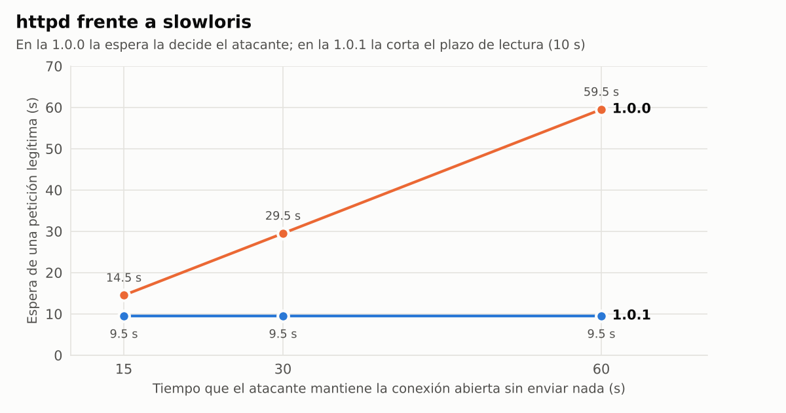
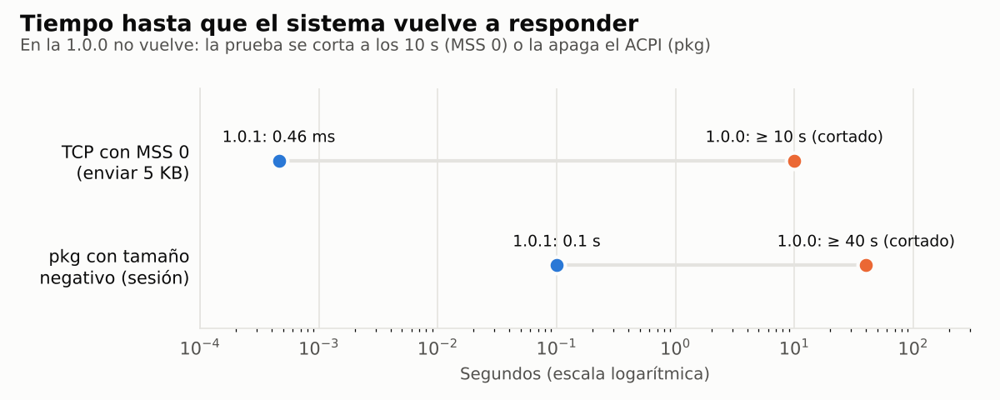
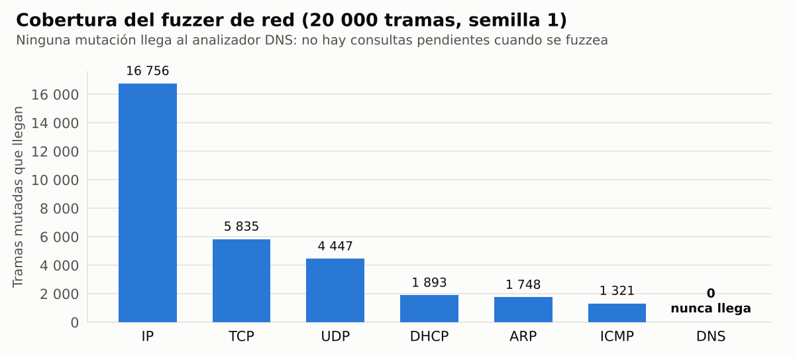

# 🛡️ Informe de seguridad — PyOS v1.0.1

**Fecha de la medición:** 2026-11-21 · **Compara:** v1.0.0 → v1.0.1 · **Release:** [v1.0.1](https://github.com/Elmoderador/PyOS/releases/tag/v1.0.1)

Cada ataque de la auditoría se lanzó **contra las dos versiones**, con el mismo código de ataque, cada uno en su propio proceso y con un límite de tiempo. Todo lo de esta página está **medido**, nada está estimado: los datos en bruto están en [`data/`](data/) y la forma de repetirlo, al final.

| | v1.0.0 | v1.0.1 |
|---|:---:|:---:|
| **Escenarios de ataque que funcionan** | **13 de 13** | **0 de 13** |

* * *

## 📋 Antes y después

❌ = el ataque funciona · ✅ = el sistema resiste. El texto de cada celda es lo que se observó.

### 🌐 Red (atacante en la red local o en internet)

| Ataque | v1.0.0 | v1.0.1 |
|---|---|---|
| SYN con **MSS 0** a un puerto abierto, y luego enviar 5 KB | ❌ Kernel colgado (más de 10 s, se cortó la prueba) | ✅ MSS acotado a 88; 5 KB enviados en 0,46 ms |
| Respuesta DHCP con la **opción 53 vacía** (servidor DHCP falso) | ❌ `IndexError` durante el arranque | ✅ Respuesta descartada; DHCP sigue esperando |
| Respuesta DHCP con **direcciones de menos de 4 bytes** | ❌ `TypeError` en la pila | ✅ Direcciones descartadas; configuración válida |
| Segmentos TCP con **data offset imposible** | ❌ `struct.error`: unpack requires a buffer of 2 bytes | ✅ Segmentos descartados |
| Respuesta DNS con un **registro A truncado** (anuncia 4 bytes y trae 2) | ❌ Devuelve una "IP" de 2 bytes al programa | ✅ Registro ignorado |
| Trama que hace fallar a la pila (**red de seguridad**) | ❌ La excepción sube hasta el kernel | ✅ Descartada, contada y registrada |

### 🧠 Kernel

| Ataque | v1.0.0 | v1.0.1 |
|---|---|---|
| Driver que lanza una excepción en su **IRQ** | ❌ La excepción sube hasta el kernel | ✅ Fallo registrado; el otro driver atendió 4 de 4 IRQ |
| **Fuzzer de syscalls** (70 syscalls con argumentos hostiles) | ❌ El kernel aguanta las 70, pero `dmesg` queda roto¹ | ✅ El kernel aguanta las 70 y `dmesg` sigue intacto |
| `klog` con un sustituto Unicode, ESC y saltos de línea | ❌ `dmesg` roto para todos los usuarios | ✅ Texto saneado; `dmesg` intacto |

¹ Misma causa que la fila de `klog`: uno de los valores del fuzzer es un sustituto Unicode suelto.

### 🔒 Aislamiento de la PVM

| Ataque | v1.0.0 | v1.0.1 |
|---|---|---|
| `str.format` con campos como `{0.__class__.__init__.__globals__}` | ❌ **4 de 6** cargas leen objetos del anfitrión² | ✅ 0 de 6 |

² Una de ellas devolvió el diccionario `__globals__` del módulo `pyos.kernel.cpu.vm`, es decir, el propio intérprete de la PVM. Las otras 2 cargas ya fallaban en la 1.0.0 por otros motivos: una especificación de formato inválida y un atributo que no existe. Detalle de cada una en [`data/strformat-1.0.0.json`](data/strformat-1.0.0.json).

### 📦 Servicios y herramientas

| Ataque | v1.0.0 | v1.0.1 |
|---|---|---|
| **4 paquetes `pkg` maliciosos** (nombre con `../`, fichero del sistema base, registro de otro paquete, dependencia con `../`) | ❌ **4 de 4** funcionan: `/sbin/svc.py` sustituido por un troyano y registro de LOOK falsificado | ✅ 4 de 4 rechazados; el paquete legítimo se instala |
| Paquete con un **tamaño negativo** calculado para volver a su propia línea | ❌ `pkg` en bucle infinito; la consola no vuelve | ✅ Rechazado: "tamaño negativo en /opt/x" |
| **XSS** en la página 404 de `httpd` (`/<script>alert(1)</script>`) | ❌ El `<script>` se refleja tal cual en el HTML | ✅ Escapado como `&lt;script&gt;` |
| **Slowloris** contra `httpd` (conectar y no enviar nada) | ❌ La petición legítima espera lo que quiera el atacante | ✅ Espera como mucho 10 s (ver gráfica) |

* * *

## 📈 Gráficas

### httpd frente a slowloris

Un programa abre una conexión con `httpd` y se queda callado. Mientras tanto, una petición legítima intenta descargar la página principal. Se repitió con el atacante callado durante 15, 30 y 60 s.

<picture>
  <source media="(prefers-color-scheme: dark)" srcset="img/slowloris-dark.png">
  
</picture>

| Atacante callado | v1.0.0 | v1.0.1 |
|---:|---:|---:|
| 15 s | 14,5 s | 9,5 s |
| 30 s | 29,5 s | 9,5 s |
| 60 s | 59,5 s | 9,5 s |

En la 1.0.0 la espera crece con el atacante sin límite: si el atacante no se va, la web no vuelve. En la 1.0.1 es constante: el plazo de lectura (10 s) menos los 0,5 s que pasan entre el ataque y la petición.

### Tiempo hasta que el sistema vuelve a responder

<picture>
  <source media="(prefers-color-scheme: dark)" srcset="img/tiempos-dark.png">
  
</picture>

Los valores de la 1.0.0 son **mínimos, no duraciones**: el sistema no volvía, y la prueba se cortó a los 10 s (MSS 0) o terminó con el apagado ACPI forzado a los 40 s (`pkg`). La escala es logarítmica porque la diferencia es de más de cuatro órdenes de magnitud.

* * *

## ⚠️ Lo que este informe no demuestra

**El fuzzer de red no encontró ninguno de los fallos de red.** Los fallos de red de la tabla salieron de la revisión del código y de pruebas dirigidas, no del fuzzer. En las dos versiones el fuzzer da 0 fallos en 20 000 tramas, y no porque la 1.0.0 fuera segura. Al medir cuántas tramas mutadas llega a ver cada analizador, aparece el motivo:

<picture>
  <source media="(prefers-color-scheme: dark)" srcset="img/fuzz-cobertura-dark.png">
  
</picture>

- **DNS: 0 tramas.** Cuando se fuzzea no queda ninguna consulta pendiente, así que la pila descarta las respuestas antes de analizarlas.
- **DHCP** sí recibe tramas, pero con la pila ya configurada. El fallo de la opción 53 solo existe durante el arranque.
- **MSS 0** no cuelga al recibir el SYN, sino después, al **enviar** datos, y el fuzzer nunca envía.

Hace falta un fuzzer **con estado**, que mute las tramas en cada fase (arranque DHCP, consultas DNS a medias, conexiones enviando). Queda pendiente para una versión futura.

**Otras limitaciones:**
- **Slowloris queda mitigado, no eliminado.** `httpd` sigue atendiendo de uno en uno: un atacante que reconecta sin parar puede seguir añadiendo hasta 10 s de espera por conexión.
- **Sin cuotas de memoria ni de CPU por proceso**, en ninguna de las dos versiones. Está documentado como límite conocido en [SECURITY.md](../../../SECURITY.md).
- **Los tiempos dependen de la máquina.** Lo que importa es la diferencia entre versiones, no el valor absoluto. Se midió con la máquina emulada de PyOS sobre CPython 3.13 en Linux, no en el arranque UEFI con CPython 3.6.8. Los fallos se verificaron también en Python 3.6, pero las cifras de esta página son del emulador.

* * *

## 🔁 Cómo repetirlo

Las herramientas están en el `.zip` de la [Release v1.0.1](https://github.com/Elmoderador/PyOS/releases/tag/v1.0.1):

- `tests/secbench.py` lanza los ataques y escribe un JSON;
- `tests/secplots.py` dibuja las gráficas a partir de esos JSON.

```sh
# 1.0.1
cd PyOS-v1.0.1
python3 tests/secbench.py --all v1.0.1.json

# 1.0.0: los mismos ataques, sobre el código de la 1.0.0
cd PyOS-v1.0.0
cp ../PyOS-v1.0.1/tests/{secbench,test_sec,test_netsec,netfuzz,sysfuzz}.py tests/
python3 tests/secbench.py --all v1.0.0.json

# slowloris con distintas duraciones (en cada versión)
python3 tests/secbench.py httpd 15000 > httpd-15000.json
```

Los JSON de [`data/`](data/) son exactamente los que generaron esta página.
