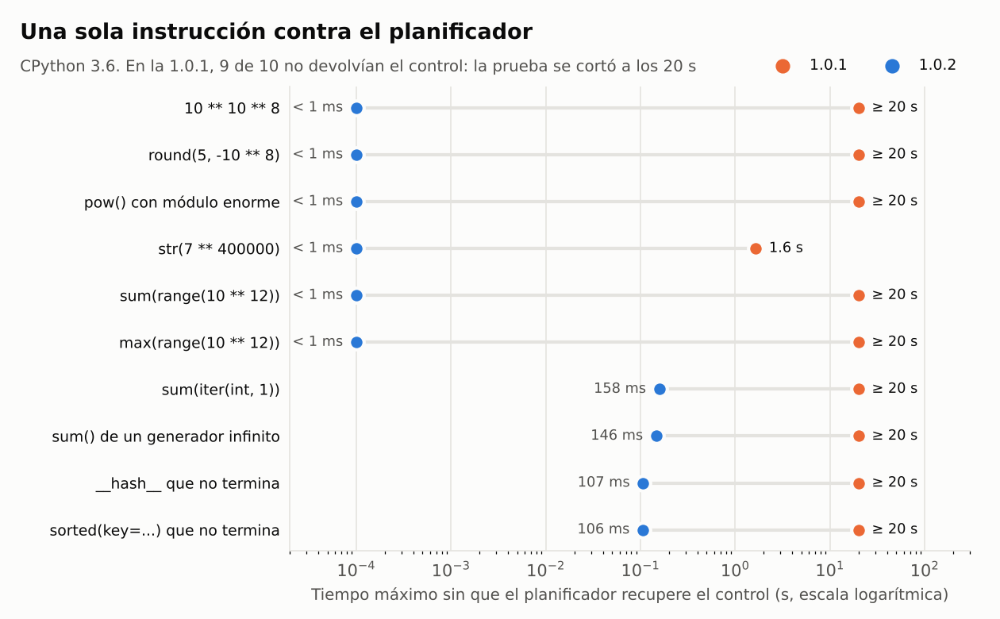
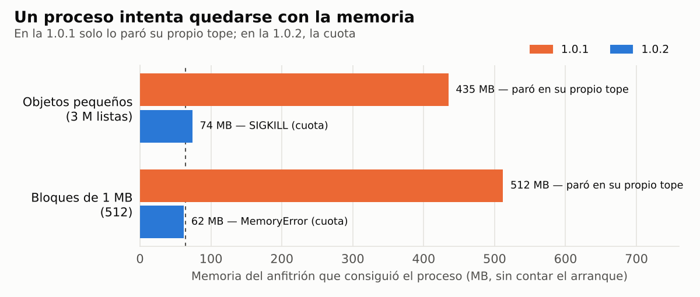
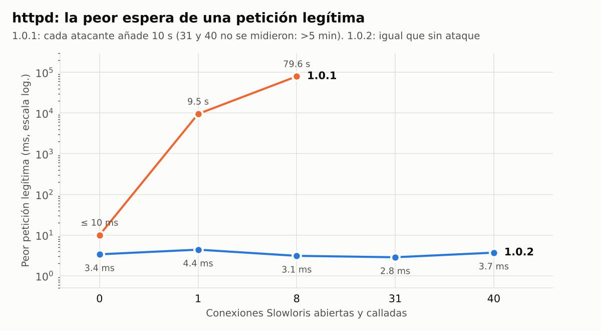
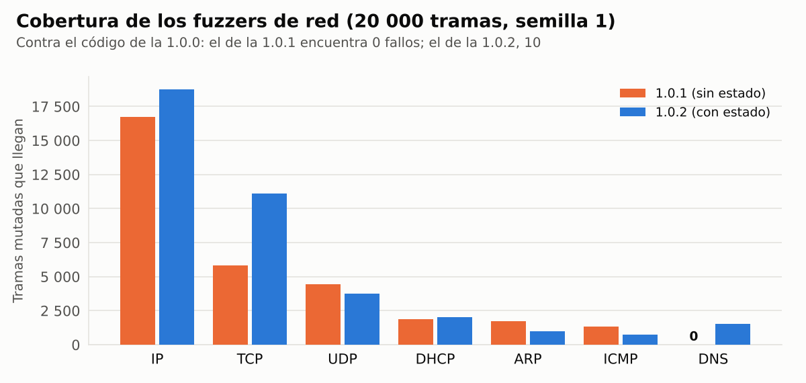

# 🛡️ Informe de seguridad — PyOS v1.0.2 (Shield Update II)

**Fecha de la medición:** 2026-11-22 · **Compara:** v1.0.1 → v1.0.2 · **Release:** [v1.0.2](https://github.com/Elmoderador/PyOS/releases/tag/v1.0.2) · Informe anterior: [v1.0.1](../v1.0.1/)

La 1.0.1 terminó con tres límites documentados. Esta versión los cierra, y aquí se miden lanzando los mismos ataques contra las dos versiones. Todo lo de esta página está **medido**; los datos en bruto están en [`data/`](data/).

| | v1.0.1 | v1.0.2 |
|---|:---:|:---:|
| **Instrucciones que congelan el planificador** (de 10) | **9** (≥ 20 s, la prueba se cortó) | **0** (máx. 0,16 s) |
| **Memoria que consigue un solo proceso** | sin límite (435–512 MB, hasta su propio tope) | **cuota: 64 MB** |
| **Peor espera de `httpd` con Slowloris** (8 conexiones) | **79,6 s** | **3,1 ms** |
| **Fallos que el fuzzer de red encuentra en el código de la 1.0.0** | **0** | **10** |
| Escenarios de ataque de la auditoría 1.0.1 que siguen cerrados | — | **13 de 13** |

* * *

## 🧠 1. Una sola instrucción contra el planificador

El planificador de PyOS expulsa a un proceso **entre** instrucciones de la PVM. Pero una sola instrucción puede ejecutar C del anfitrión, y durante ese tiempo no hay nadie que pueda expulsarla. Cada ataque se ejecutó en rodajas de 300 instrucciones, como lo hace el kernel, y se midió la rodaja más larga. El intérprete fue **CPython 3.6**, el del arranque UEFI.

<picture>
  <source media="(prefers-color-scheme: dark)" srcset="img/cpu-dark.png">
  
</picture>

| Ataque | v1.0.1 | v1.0.2 |
|---|---|---|
| `10 ** 10 ** 8` | ❌ congelado ≥ 20 s | ✅ `OverflowError` (< 1 ms) |
| `round(5, -10 ** 8)` | ❌ congelado ≥ 20 s | ✅ devuelve 0 sin calcular `10 ** 10 ** 8` |
| `pow()` con módulo de 130 000 bits | ❌ congelado ≥ 20 s | ✅ `OverflowError` (modelo de coste) |
| `str(7 ** 400000)` | ❌ 1,6 s sin control | ✅ `OverflowError` (enteros de hasta 131 072 bits) |
| `sum(range(10 ** 12))` | ❌ congelado ≥ 20 s | ✅ `OverflowError` (< 1 ms) |
| `max(range(10 ** 12))` | ❌ congelado ≥ 20 s | ✅ `OverflowError` (< 1 ms) |
| `sum(iter(int, 1))` | ❌ congelado ≥ 20 s | ✅ `OverflowError` en 158 ms |
| `sum()` de un generador infinito | ❌ congelado ≥ 20 s | ✅ `TimeoutError` en 146 ms |
| `__hash__` que no termina | ❌ congelado ≥ 20 s | ✅ `TimeoutError` en 107 ms |
| `sorted(key=...)` que no termina | ❌ congelado ≥ 20 s | ✅ `TimeoutError` en 106 ms |

Las tres últimas filas son la clase más grave. Cuando C llama a código del usuario (un `key=`, un `__hash__`, un generador que consume `sum()`), ese código se ejecutaba **sin expropiación**: no hacía falta ningún entero gigante, bastaba un bucle infinito en el sitio adecuado. En la 1.0.2 comparte un presupuesto de 250 000 instrucciones por rodaja y, si lo agota, falla con `TimeoutError`.

* * *

## 💾 2. Un proceso intenta quedarse con la memoria

Dos programas intentan acaparar memoria dentro del sistema emulado. Uno crea 3 millones de listas pequeñas y el otro, 512 bloques de 1 MB con contenido. Se mide la memoria máxima del anfitrión, restando la que ocupa arrancar PyOS (23–24 MB en las dos versiones).

<picture>
  <source media="(prefers-color-scheme: dark)" srcset="img/memoria-dark.png">
  
</picture>

| Programa | v1.0.1 | v1.0.2 |
|---|---|---|
| 3 M listas pequeñas | ❌ **435 MB**: llegó a sus 3 M (su propio tope, no el de PyOS) | ✅ **74 MB**: SIGKILL al medir 64 MB de heap |
| 512 bloques de 1 MB | ❌ **512 MB**: llegó a todos | ✅ **62 MB**: `MemoryError` antes de reservar el bloque 64 |

Los dos casos se detectan de forma distinta. Las reservas grandes se comprueban **antes** de hacerse, así que el programa recibe un `MemoryError` y puede tratarlo. Los objetos pequeños, en cambio, se acumulan sin pasar por ninguna guarda: los detecta un recorrido del heap por partes, entre rodajas, y el proceso muere al pasarse. Por eso el anfitrión llega a 74 MB y no a 64: el recorrido tarda un poco en ver todo lo creado, y el asignador de CPython tiene su propia sobrecarga.

* * *

## 🌐 3. `httpd` frente a Slowloris

Un programa abre *N* conexiones con `httpd` y no envía nada. Otro, dentro de PyOS, mide 100 peticiones legítimas con el reloj fino del kernel (`uptime_us`). En la 1.0.2 se hicieron 3 ejecuciones (300 peticiones) por cada *N*.

<picture>
  <source media="(prefers-color-scheme: dark)" srcset="img/httpd-dark.png">
  
</picture>

| Atacantes | v1.0.1: peor petición | v1.0.2: mediana | v1.0.2: p95 | v1.0.2: peor |
|---:|---:|---:|---:|---:|
| 0 | ≤ 10 ms | 2,28 ms | 2,66 ms | 3,36 ms |
| 1 | **9,5 s** | 1,93 ms | 2,58 ms | 4,38 ms |
| 8 | **79,6 s** | 1,99 ms | 2,39 ms | 3,09 ms |
| 31 | no medido (> 5 min) | 2,16 ms | 2,63 ms | 2,85 ms |
| 40 | no medido | 2,34 ms | 2,70 ms | 3,69 ms |

En la 1.0.1, `httpd` atendía de uno en uno, así que cada atacante sumaba sus 10 s de plazo a la cola. En la 1.0.2 es un bucle de eventos sobre la nueva syscall `poll()`: atiende 32 conexiones a la vez y, si se llenan, expulsa a la más antigua que no haya terminado su petición. Con 40 atacantes ya está lleno.

**¿Añade el ataque algún milisegundo?** Con lo medido no se puede afirmar. Entre ejecuciones distintas, la mediana de una misma configuración varía unos ±0,4 ms, y las medianas con atacantes (1,93–2,34 ms) quedan dentro de ese margen respecto a la de sin atacantes (2,28 ms). Lo que sí está claro es que la espera **ya no depende del atacante**.

* * *

## 🔎 4. El fuzzer de red, otra vez contra la 1.0.0

El informe de la 1.0.1 dejó escrito que su fuzzer **no había encontrado ninguno de los fallos de red**. El de la 1.0.2 graba una sesión como guion y deja la pila en el estado exacto en que espera cada trama: arrancando DHCP, con una consulta DNS abierta o con una conexión enviando datos. Muta esa trama con mutaciones que entienden el protocolo y comprueba tres oráculos: excepciones, cuelgues y estados imposibles. Los dos fuzzers se lanzaron contra el código de la **1.0.0**, la versión con los fallos, con 20 000 tramas y semilla 1.

<picture>
  <source media="(prefers-color-scheme: dark)" srcset="img/fuzz-dark.png">
  
</picture>

| | Fuzzer de la 1.0.1 | Fuzzer de la 1.0.2 |
|---|:---:|:---:|
| Fallos distintos en el código de la 1.0.0 | **0** | **10** |
| Tramas mutadas que llegan al analizador DNS | 0 | 1 510 |

Los 10 fallos cubren las cinco clases de fallo de red que la auditoría de la 1.0.1 encontró a mano:

| Clase (1.0.1) | Lo que encontró el fuzzer de la 1.0.2 |
|---|---|
| DHCP: opción 53 vacía | `IndexError` en `_dhcp_in` |
| DHCP: direcciones cortas | `TypeError` en `ip2s` y `struct.error` en `_dhcp_in` |
| TCP: *data offset* imposible | 2 × `IndexError` y 1 × `struct.error` en `_parse_mss` |
| TCP: MSS 0 | **cuelgue** como cliente y como servidor, e invariante "MSS = 0" |
| DNS: registro A truncado | invariante "DNS devuelve una IP de 1 byte" |

Contra la 1.0.1 y la 1.0.2 encuentra **0**.

Además, se encontró un fallo **en el propio fuzzer de la 1.0.1**. `fix_checksums` sumaba el relleno Ethernet, así que rompía la suma de comprobación de toda trama TCP de menos de 60 bytes: SYN, SYN-ACK y ACK. Sus mutaciones nunca pasaban de la comprobación de la suma, y por eso ningún fuzzer podía llegar al MSS ni al *data offset*.

* * *

## 🖥️ 5. En el arranque UEFI real

[`data/uefi-cuotas.log`](data/uefi-cuotas.log) es una sesión completa en QEMU + OVMF con el CPython 3.6.8 de edk2. En ella:

- `10 ** 10 ** 8` y `sum(iter(int, 1))` dan `OverflowError`, y el `__hash__` infinito, `TimeoutError`;
- `[[i, i] for i in range(3000000)]` muere al llegar a 64 MB;
- un programa con `setrlimit("cpu", 1)` muere a su segundo de CPU;
- `httpd` y la shell siguen respondiendo después.

**Encontrado aquí y corregido antes de publicar.** El CPython de edk2 se compila **sin pymalloc**, así que `sys.getallocatedblocks()` siempre vale 0, y esa era la señal que usaba el kernel para saber que un proceso crecía. Sin ella, en la primera prueba UEFI la lista de 3 M elementos dejó sin memoria la VM de 512 MB antes de que se la midiera. Ahora la señal sale de los contadores del recolector de basura, y `tests/test_quota.py` simula ese CPython.

* * *

## ⚖️ 6. Lo que cuesta

Las guardas tienen precio. Se midió `tests/pvm_bench.py` en CPython 3.6 con 10 ejecuciones intercaladas de las dos versiones, tomando el mínimo para descontar las interferencias del anfitrión:

| Carga | v1.0.1 | v1.0.2 | Cambio |
|---|---:|---:|---:|
| bucles | 0,496 s | 0,497 s | +0,2 % |
| llamadas | 0,619 s | 0,695 s | +12,3 % |
| objetos | 0,497 s | 0,519 s | +4,4 % |
| cadenas | 0,381 s | 0,417 s | +9,4 % |
| **total** | 2,006 s | 2,179 s | **+8,6 %** |

LOOK arranca en UEFI en 2270 ms, frente a 2220 ms en la 1.0.1 (+2 %).

**Límites nuevos que pueden romper programas.** Pasan a dar error, en lugar de congelar el sistema:

- recorrer más de 1 000 000 de elementos en una sola builtin (200 000 si vienen de un iterador perezoso): `sum(range(2_000_000))` da `OverflowError` y hay que hacerlo con un bucle;
- los enteros de más de 131 072 bits;
- los anchos de formato de más de 1 048 576;
- `sorted(key=...)` sobre más de unos 10 000 elementos, por el presupuesto anidado.

* * *

## ⚠️ Lo que este informe no demuestra

- **Que las rodajas duren lo mismo en tu máquina.** Los tiempos de CPU se midieron en CPython 3.6 nativo. En el QEMU de estas pruebas, que emula la CPU por software y va unas 25 veces más lento, la misma guarda tardó 2,5 s en lugar de 0,16 s; con virtualización por hardware (VirtualBox, KVM) se espera algo cercano al nativo, pero eso no se midió.
- **Que el ataque añada exactamente 0 ms a `httpd`.** Solo que lo que añada queda por debajo del ruido de medida (±0,4 ms).
- **Las medianas de la 1.0.1.** Esa versión no tenía reloj fino, así que sus latencias se ven a resolución de tick (10 ms). Sus esperas de segundos sí son exactas.
- **Que la cuota se cumpla al byte.** Lo que se acumula poco a poco se detecta midiendo, y el proceso puede pasarse un momento antes de morir. Está documentado en [SECURITY.md](../../../SECURITY.md).
- **Que no queden fallos de red.** El fuzzer con estado encuentra lo que se sabía que había en la 1.0.0. Que no encuentre nada en la 1.0.2 es una buena señal, no una prueba.
- **Hallazgo aparte, sin consecuencias de seguridad.** El compilador de la PVM evalúa las expresiones generadoras como listas: `any(x for x in g)` no cortocircuita. Sigue siendo expropiable y está anotado para una versión de arreglos (P).

* * *

## 🔁 Cómo repetirlo

Las herramientas están en el `.zip` de la [Release v1.0.2](https://github.com/Elmoderador/PyOS/releases/tag/v1.0.2):

```sh
cd PyOS-v1.0.2
# CPU, con el intérprete del arranque UEFI (3.6), cortando a los 20 s
SECBENCH_PY=python3.6 python3 tests/secbench.py --cpu cpu-1.0.2.json 20
# memoria: 'pequeños', 'grandes' o 'ninguno' (línea base)
python3 tests/secbench.py --x mem pequeños
# httpd: 100 peticiones con N conexiones Slowloris
python3 -c "from tests.secbench import a_httpd_latencia as f; print(f(40, 100))"
# los ataques de la auditoría 1.0.1
python3 tests/secbench.py --all ataques.json
# gráficas
python3 tests/secplots.py <dir_datos> <dir_imagenes> 1.0.2
# cuotas en el arranque UEFI real (QEMU + OVMF)
python3 tests/uefi_quota.py build/uefi/pyos-uefi.img
```

Para la 1.0.1, copia `tests/secbench.py` de este `.zip` al de la 1.0.1. Para comparar fuzzers, ejecuta `tests/netfuzz.py` (con estado) y el `tests/netfuzz.py` del `.zip` de la 1.0.1 sobre el código de la 1.0.0.
